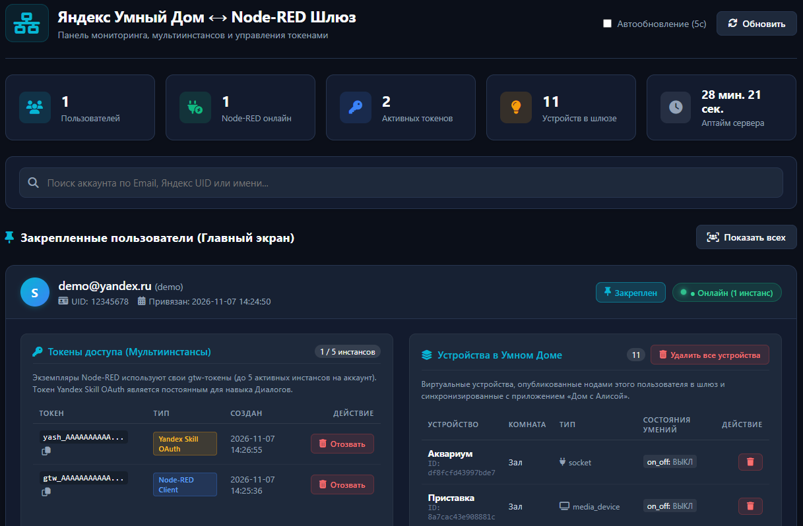

# 🏠 Yandex Smart Home Gateway (Backend для node-red-contrib-alice)

Приватный шлюз Умного Дома и собственный бэкенд для ноды **node-red-contrib-alice**. 
Позволяет управлять виртуальными устройствами из приложения «Дом с Алисой» и умных колонок Яндекса через собственный защищённый сервер без сторонних платных облаков.

---




## ✨ Основные возможности

- 🚀 **Высокая скорость (Keep-Alive & WebSocket):** Пул постоянных HTTP-соединений с Яндексом и двусторонний WebSocket для мгновенного выполнения голосовых команд (задержка < 200 мс).
- 👥 **Изоляция аккаунтов:** Разделение токенов, виртуальных устройств и очередей команд по пользователям.
- 🔌 **Поддержка нескольких подключений:** До 5 одновременных экземпляров Node-RED на один аккаунт с автоматической ротацией старых токенов по FIFO.
- 🔐 **Безопасный OAuth 2.0:** Честный обмен verification code, поддержка `authorization_code` и `refresh_token`, защита от фиктивных токенов и подмены аккаунтов.
- 📊 **Веб-панель управления (порт 5001):**
  - Мониторинг аптайма, подключенных сокетов, пользователей и устройств в реальном времени.
  - Живой поиск аккаунтов по Email, Яндекс UID или имени.
  - Закрепление избранных пользователей на главной странице (📌).
  - Просмотр и отзыв выданных токенов доступа.
  - Просмотр состояний умений/датчиков и кнопка пакетного удаления устройств аккаунта.
  - Кнопка полного удаления аккаунта со всеми токенами, устройствами и автоматическим удалением из Яндекс Диалогов (🗑️).
- 🐳 **Готовность к Docker & Dockge:** Multi-arch поддержка (`linux/amd64`, `linux/arm64` для Armbian/TV-боксов s905x3/Raspberry Pi), healthcheck и сохранение SQLite базы в persistent volume.

---

## 🏗 Архитектура

```
                           ┌────────────────────────┐
                           │   Яндекс Диалоги       │
                           │ (Алиса / Дом с Алисой) │
                           └───────────┬────────────┘
                                       │ HTTPS / OAuth 2.0
                                       ▼
                     ┌───────────────────────────────────┐
                     │    Yandex Gateway (Port 5000)     │
                     │  - OAuth 2.0 (/auth, /token)      │
                     │  - Smart Home API (/v1.0/...)     │
                     │  - Discovery & State Callbacks    │
                     │  - WebSocket Hub (/v1/ws)         │
                     └───────┬───────────────────┬───────┘
                             │                   │
                SQLite DB    │                   │ WebSocket (Keep-Alive)
             (Persistent)    │                   │
                             ▼                   ▼
           ┌───────────────────────┐   ┌───────────────────────────┐
           │     gateway.db        │   │   Node-RED Instance(s)    │
           │  (Users, Tokens,      │   │ node-red-contrib-alice-mod│
           │   Devices, States)    │   └───────────────────────────┘
           └───────────────────────┘
                             ▲
                             │ Внутренний доступ
           ┌─────────────────┴───────────────────┐
           │     Admin Dashboard (Port 5001)     │
           │  - Поиск пользователей по UID/Email │
           │  - Закрепление на главной (📌)      │
           │  - Управление токенами и очистка БД │
           └─────────────────────────────────────┘
```

---

## ⚙️ Настройка в консоли Яндекса

Для работы шлюза с Алисой требуются два компонента в Яндексе:

### 1. Приложение в Яндекс OAuth ([oauth.yandex.ru](https://oauth.yandex.ru))
1. Нажмите **Создать приложение**.
2. **Название:** Например, `Node-RED Smart Home Gateway`.
3. **Платформы:** выберите `Веб-сервисы`.
4. **Redirect URI:** `https://<ваш_домен>/yandex_callback`
5. **Redirect URI:** `https://<ваш_домен>/verification_code`
6. **Доступы:**
   - `login:email` (доступ к адресу электронной почты)
   - `login:info` (доступ к имени, фамилии и полу)
   - `login:avatar` (доступ к портрету пользователя)
7. Скопируйте **Client ID** и **Client Secret** в `.env`:
   ```ini
   YANDEX_OAUTH_CLIENT_ID=ваш_client_id
   YANDEX_OAUTH_SECRET=ваш_client_secret
   ```

### 2. Навык Умного Дома ([dialogs.yandex.ru/developer](https://dialogs.yandex.ru/developer))
1. Нажмите **Создать диалог** ➔ **Умный дом**.
2. **Endpoint URL:** `https://<ваш_домен>:5000/v1.0`
3. Перейдите во вкладку **Связка аккаунтов**:
   - **Идентификатор приложения (Client ID):** любое произвольное слово (например, `my_nodered_gateway`)
   - **Секрет приложения (Client Secret):** любой произвольный секретный ключ
   - **URL авторизации:** `https://<ваш_домен>:5000/auth`
   - **URL для получения токена:** `https://<ваш_домен>:5000/token`
   - **URL для обновления токена:** `https://<ваш_домен>:5000/token`
4. Скопируйте значения в `.env`:
   ```ini
   SMART_HOME_CLIENT_ID=my_nodered_gateway
   SMART_HOME_CLIENT_SECRET=ваш_секрет
   ```
5. В строке браузера скопируйте ID навыка (UUID в URL после `/skills/`) в `YANDEX_SKILLS_ID`.
6. Выпустите OAuth токен разработчика с правами `dialogs:skills` по [инструкции Яндекса] и укажите его в `YANDEX_SKILL_OAUTH_TOKEN`.

---

## 🔌 Установка ноды в Node-RED (`node-red-contrib-alice-mod`)

1. Перейдите в каталог с нодой и выполните сборку:
   ```bash
   cd node-red-contrib-alice-mod
   npm install
   npm run build
   ```
2. Подключите ноду в глобальный Node-RED:
   ```bash
   npm link
   cd ~/.node-red   # для Windows: C:\Users\<Имя>\.node-red
   npm link node-red-contrib-alice
   ```
3. Перезапустите Node-RED.
4. В конфигурации ноды `alice-service`:
   - Укажите URL вашего шлюза (например, `http://localhost:5000` или внешний адрес `https://gateway.example.com`).
   - Поле **Client ID** загрузится автоматически из шлюза (также его можно ввести или отредактировать вручную).
   - Нажмите кнопку **«Yandex Authentication»** — откроется страница авторизации Яндекс с вашим Client ID.
   - Скопируйте полученный verification code, вставьте в поле и нажмите **«Получить токен»**.
   - Нажмите «Готово» и «Развернуть» (Deploy) в Node-RED. Токен и профиль пользователя надёжно сохранены.

---

## 📋 Таблица переменных окружения (.env)

| Переменная | По умолчанию | Описание |
|---|---|---|
| `GATEWAY_HOST` | `0.0.0.0` | IP-адрес для привязки шлюза |
| `GATEWAY_PORT` | `5000` | Порт шлюза (Яндекс Диалоги и Node-RED) |
| `DASHBOARD_HOST` | `0.0.0.0` | IP-адрес веб-панели управления |
| `DASHBOARD_PORT` | `5001` | Порт веб-панели управления |
| `LOG_LEVEL` | `INFO` | Уровень логирования (`DEBUG`, `INFO`, `WARNING`, `ERROR`) |
| `DATA_DIR` | `/data` | Директория для хранения `gateway.db` |
| `MAX_USER_TOKENS` | `5` | Максимальное число активных инстансов Node-RED на аккаунт |
| `YANDEX_OAUTH_CLIENT_ID` | — | Client ID из oauth.yandex.ru |
| `YANDEX_OAUTH_SECRET` | — | Client Secret из oauth.yandex.ru |
| `SMART_HOME_CLIENT_ID` | — | Идентификатор клиента во вкладке «Связка аккаунтов» |
| `SMART_HOME_CLIENT_SECRET`| — | Секрет клиента во вкладке «Связка аккаунтов» |
| `YANDEX_SKILLS_ID` | — | UUID созданного навыка в Яндекс Диалогах |
| `YANDEX_SKILL_OAUTH_TOKEN`| — | OAuth-токен создателя навыка для callback-уведомлений |

---

## 🔒 Безопасность

- При публичном развёртывании шлюз на порту `5000` рекомендуется закрывать HTTPS с помощью обратного прокси (Nginx, Caddy, Traefik).
- Панель управления на порту `5001` содержит административные функции мониторинга и отзыва токенов, держите её в локальной сети либо закройте Basic Auth на прокси.

---

## 💖 Благодарности

Этот проект сделан на основе форка плагина [node-red-contrib-alice](https://github.com/efa2000/node-red-contrib-alice) от автора **efa2000**. Выражаем благодарность автору за разработку оригинальной ноды и фундамент интеграции с экосистемой Яндекс Алисы!

---

## 📄 Лицензия

MIT License. Вы можете свободно использовать, модифицировать и разворачивать проект на своих серверах.
